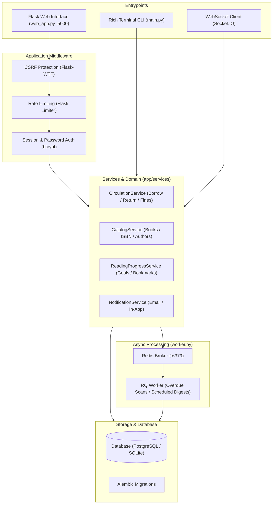

# Book-Tale

<p align="center">
  
</p>

<p align="center">
  
  
  
  
  
  
  <a href="./LICENSE"></a>
</p>

> A comprehensive, dual-interface library management and patron engagement platform built with Flask, SQLAlchemy, Socket.IO real-time event broadcasting, Redis RQ background workers, and a Rich terminal CLI. It streamlines book cataloging, member borrowing workflows, fine settlements, reading progress tracking, and QR code asset tagging across 579 automated tests.

**Status:** Prototype portfolio project. Built to demonstrate full-stack Python application design, dual web and terminal entry points, schema migrations with Alembic, and event-driven background job processing.

<!-- TODO[L2-01]: Capture screenshots of the patron catalog search and admin circulation dashboard; save to docs/assets/screenshots/dashboard.png (owner: Maintainer) -->

<p align="center">
  <a href="#what-it-does">What It Does</a> •
  <a href="#quick-facts">Quick Facts</a> •
  <a href="#architecture">Architecture</a> •
  <a href="#tech-stack">Tech Stack</a> •
  <a href="#engineering-features">Engineering Features</a> •
  <a href="#quick-start">Quick Start</a> •
  <a href="#configuration">Configuration</a> •
  <a href="#testing">Testing</a> •
  <a href="./LICENSE">License</a>
</p>

---

## What It Does

Book-Tale provides complete operational infrastructure for physical and digital library systems:

1. **Circulation & Lending:** Automates borrow and return workflows, checks active borrowing limits, calculates overdue fines daily, and tracks reservation waitlists.
2. **Dual-Interface Operation:** Offers both an interactive browser dashboard (Flask + Jinja2 + Socket.IO) and a terminal interface (Rich CLI) sharing the same underlying service layer.
3. **Real-Time Notifications:** Emits instant loan reminders and return confirmations using Flask-SocketIO web sockets.
4. **Patron Engagement:** Tracks personal reading lists, bookmarks, reading progress notes, book ratings, reviews with spoiler tags, and book club discussions.
5. **Asset Tagging & QR Codes:** Generates scannable QR code badges for book inventory and patron library cards using `pyqrcode` and `pypng`.
6. **Background Job Processing:** Asynchronously dispatches overdue notifications, membership renewals, and fine recalculations via Redis RQ workers (`worker.py`).

---

## Quick Facts

| Dimension             | Specification                                           | Evidence Source                         |
| :-------------------- | :------------------------------------------------------ | :-------------------------------------- |
| Project Type          | Full-Stack Web Application & Terminal CLI               | `pyproject.toml`, `requirements.txt`    |
| Primary Language      | Python (>= 3.12)                                        | `pyproject.toml:8`, `Dockerfile`        |
| Primary Web Framework | Flask (3.1+), Flask-SocketIO (5.7+), Flask-WTF (1.3+)   | `requirements.txt:4,20,21`              |
| Database & ORM        | SQLAlchemy (2.1+), Alembic (1.20+), SQLite / PostgreSQL | `requirements.txt:27-29`, `alembic.ini` |
| Task Queue & Broker   | Redis (8.1+), RQ (2.12+)                                | `requirements.txt:24,25`                |
| Terminal Presentation | Rich (15.0+)                                            | `requirements.txt:3`                    |
| Test Suite            | 579 collected tests across 42 test modules              | `tests/` directory (`pytest`)           |
| License               | MIT License                                             | `LICENSE` file                          |

---

## Architecture



_Data flow summary: Requests arrive via web or terminal CLI. Core circulation and catalog services enforce borrowing limits and fine policies. Balance and inventory mutations persist through SQLAlchemy to SQLite or PostgreSQL, while deferred tasks (overdue scans and notifications) are processed asynchronously via Redis RQ workers._

---

## Tech Stack

### Web & Backend

- **Runtime:** Python 3.12+
- **Web Framework:** Flask (v3.1.3+)
- **Real-Time WebSockets:** Flask-SocketIO (`flask-socketio~=5.7.0`)
- **Forms & Security:** Flask-WTF (`flask-wtf>=1.3.0`), Flask-Limiter (`flask-limiter>=4.1.1`), `bcrypt>=5.0.0`
- **ORM & Migrations:** SQLAlchemy (`sqlalchemy>=2.1.4`), Alembic (`alembic>=1.20.0`), `psycopg2-binary>=2.9.13`
- **CLI Framework:** Rich (`rich>=15.0.0`)
- **QR Code & Media:** `pyqrcode>=1.2.1`, `pypng>=0.20220715.0`, `Pillow>=12.3.0`
- **Data Analytics:** `pandas>=3.0.6`, `numpy>=2.5.3`

### Background Queue & Infrastructure

- **Task Worker:** RQ (`rq>=2.12.0`) backed by Redis (`redis>=8.1.0`)
- **Scheduler:** `croniter>=6.2.4`
- **Containerization:** Multi-stage `Dockerfile`, Docker Compose (`docker-compose.yml`)

---

## Engineering Features

### Circulation & Policy Enforcement

- **Borrow Limits:** Enforces a configurable per-patron quota (default 3 books) and maximum loan duration (default 14 days).
- **Automated Fine Calculations:** Computes overdue penalties on a per-day scale upon return and prevents new borrowings if outstanding balances exceed threshold limits.
- **Reservation Queues:** Patrons can reserve checked-out volumes, receiving automatic reallocation alerts once books are scanned back into the library.

### QR Code Physical Integration

- Every newly accessioned book automatically receives a scannable QR code carrying title, author, and ISBN metadata.
- Generated badges can be printed or exported as PNG assets for physical shelf labeling.

### Real-Time Event Dispatch

- Socket.IO integration broadcasts updates to connected patron dashboards when loan statuses change, eliminating the need for manual page refreshes.

---

## Prerequisites

Before running Book-Tale, ensure you have installed:

- **Python:** Version 3.12 or newer (`python --version`)
- **Redis:** Required for background queues and rate limiting (or run via Docker)
- **PostgreSQL:** Optional (SQLite is used by default for local development)

---

## Quick Start

### Option A — Local Web Application

#### 1. Clone the repository

```bash
git clone https://github.com/themanoj-025/BookTale.git
cd BookTale
```

#### 2. Configure Python environment

**On Windows (PowerShell):**

```powershell
python -m venv .venv
.\.venv\Scripts\Activate.ps1
pip install -r requirements.txt
pip install -e .
```

**On Linux / macOS (Bash):**

```bash
python3 -m venv .venv
source .venv/bin/activate
pip install -r requirements.txt
pip install -e .
```

#### 3. Set environment configuration

```bash
cp .env.example .env
```

_(On Windows cmd: `copy .env.example .env`). Edit `.env` to configure your `SECRET_KEY` and admin credentials._

#### 4. Apply database migrations

```bash
alembic upgrade head
```

#### 5. Launch the Web Application

```bash
python web_app.py
```

Expected output:

```text
 * Serving Flask app 'app.routes.web_app'
 * Running on http://127.0.0.1:5000 (Press CTRL+C to quit)
```

Open `http://localhost:5000` in your web browser. Default development administrator login: `ADMIN001` / `AdminDev123456`.

---

### Option B — Interactive Terminal CLI

Run the Rich-powered command-line interface directly in your terminal:

```bash
python main.py
```

Expected output:

```text
╭─────────────────────────────────────────╮
│      Library Management System (CLI)    │
╰─────────────────────────────────────────╯
[1] Book Management
[2] Member Management
[3] Borrow / Return Transactions
[4] Exit
```

---

### Option C — Background Task Worker

In a separate terminal, launch the RQ worker for scheduled fine processing and notifications:

```bash
python worker.py
```

---

### Option D — Full Stack (Docker Compose)

Launch the complete containerized stack (Flask Web App, Redis Queue, Background Worker, and PostgreSQL):

```bash
# 1. Prepare environment
cp .env.example .env

# 2. Start services
docker compose up --build -d

# 3. Follow logs
docker compose logs -f
```

The web dashboard will be available at `http://localhost:5000`. To stop containers:

```bash
docker compose down
```

---

## Configuration

Settings are parsed from your local `.env` file:

| Variable                 | Required | Default                    | Description                                       | Secret  |
| :----------------------- | :------: | :------------------------- | :------------------------------------------------ | :-----: |
| `SECRET_KEY`             | **Yes**  | `change-this...`           | Flask session and CSRF signing secret             | **Yes** |
| `DEFAULT_ADMIN_ID`       |    No    | `ADMIN001`                 | Default administrator username for initial setup  |   No    |
| `DEFAULT_ADMIN_PASSWORD` | **Yes**  | `AdminDev123456`           | Default administrator password (min 12 chars)     | **Yes** |
| `FLASK_PORT`             |    No    | `5000`                     | Port for the web server                           |   No    |
| `REDIS_URL`              |    No    | `redis://localhost:6379/0` | Redis connection URL for task queue and cache     | **Yes** |
| `ISSUE_DAYS`             |    No    | `14`                       | Maximum allowable loan duration in days           |   No    |
| `FINE_PER_DAY`           |    No    | `5.0`                      | Monetary penalty charged per day past loan expiry |   No    |
| `MAX_BORROW_LIMIT`       |    No    | `3`                        | Maximum number of concurrent loans per member     |   No    |
| `SMTP_HOST`              |    No    | `""`                       | SMTP mail server for overdue email notifications  |   No    |
| `SMTP_PASSWORD`          |    No    | `""`                       | Password for outbound SMTP authentication         | **Yes** |
| `BOOKTALE_API_KEY`       |    No    | `""`                       | API key required for programmatic REST endpoints  | **Yes** |

---

## Project Structure

```text
Book-Tale/
├── app/
│   ├── config/                    # Configuration and settings loader
│   ├── db/                        # Database connection and model repositories
│   ├── jobs/                      # RQ background job definitions (overdue scans, emails)
│   ├── models/                    # SQLAlchemy domain models (Book, User, Loan, Fine)
│   ├── routes/                    # Web controllers and CLI view logic:
│   │   ├── main.py                # Terminal CLI implementation
│   │   └── web_app.py             # Flask HTTP and Socket.IO routes
│   ├── services/                  # Business logic (circulation, catalog, reading progress)
│   ├── static/                    # Frontend CSS, JavaScript, and asset files
│   └── templates/                 # Jinja2 HTML templates for web interface
├── migrations/                    # Alembic schema evolution files
├── tests/                         # Automated test suite (579 test cases across 42 files)
├── .env.example                   # Environment configuration template
├── Dockerfile                     # Multi-stage production container build
├── docker-compose.yml             # Containerized services orchestrator
├── main.py                        # Terminal CLI entrypoint
├── pyproject.toml                 # Package definition and lint configurations
├── requirements.txt               # Pinned Python package dependencies
├── web_app.py                     # Primary Flask web application entrypoint
└── worker.py                      # Dedicated RQ background worker entrypoint
```

---

## Testing

The test suite validates database models, borrow/return transactions, fine calculations, session security, and CLI actions:

```bash
# Run the complete test suite
pytest tests/ -v

# Run unit tests only
pytest tests/ -m "unit" -v

# Run with coverage report
pytest tests/ --cov=app --cov-report=term-missing

# Run documentation anchor, link, and fence validation
python .github/scripts/lint_readme.py
```

---

## Limitations and Threat Model

- **Email Delivery Fallback:** When SMTP credentials are not configured, outbound notifications are logged locally and surfaced exclusively within the in-app notification center.
- **Single-Node Socket.IO:** In default development mode, Socket.IO sessions use in-memory state. For distributed multi-container deployments, configure the Redis message queue backend.
- **Production Secret Rotation:** The default admin password in `.env.example` must be changed immediately upon deploying to any publicly accessible network.

---

## Contributing

Contributions and feature requests are welcome! Please review [CONTRIBUTING.md](./CONTRIBUTING.md) before submitting pull requests.

1. Fork the repository.
2. Create your feature branch (`git checkout -b feature/add-audiobook-support`).
3. Commit your changes following Conventional Commits (`git commit -m 'feat: support digital audiobook loans'`).
4. Ensure all tests and linters pass (`pytest tests/` and `python .github/scripts/lint_readme.py`).
5. Open a Pull Request.

---

## Security

Please report vulnerabilities confidentially according to our security policy in [SECURITY.md](./SECURITY.md). Do not file public issues for active exploits.

---

## License

This project is licensed under the terms of the MIT License. See [LICENSE](./LICENSE) for details.
